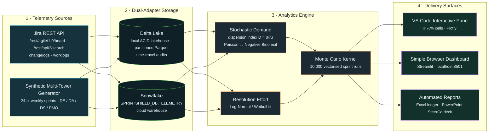
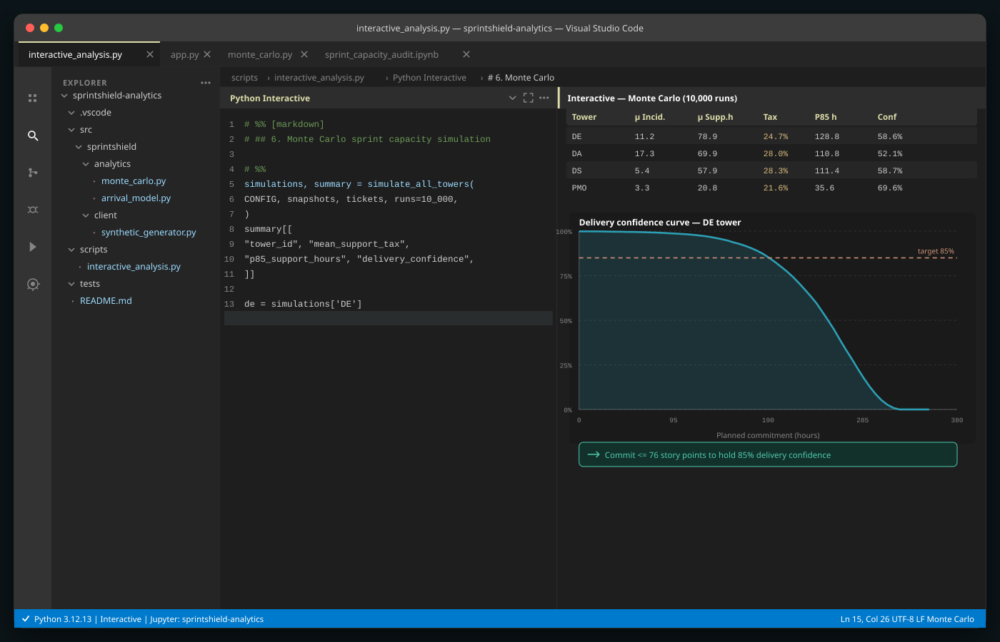
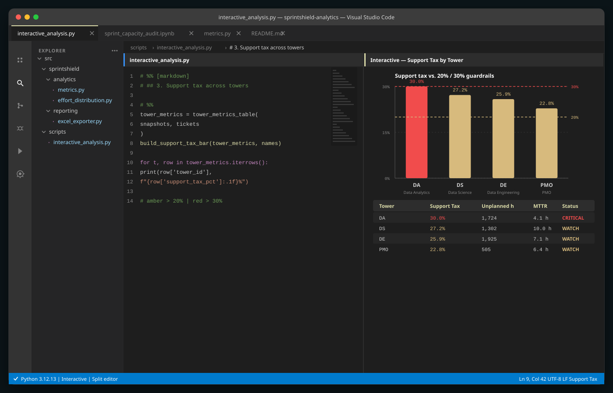
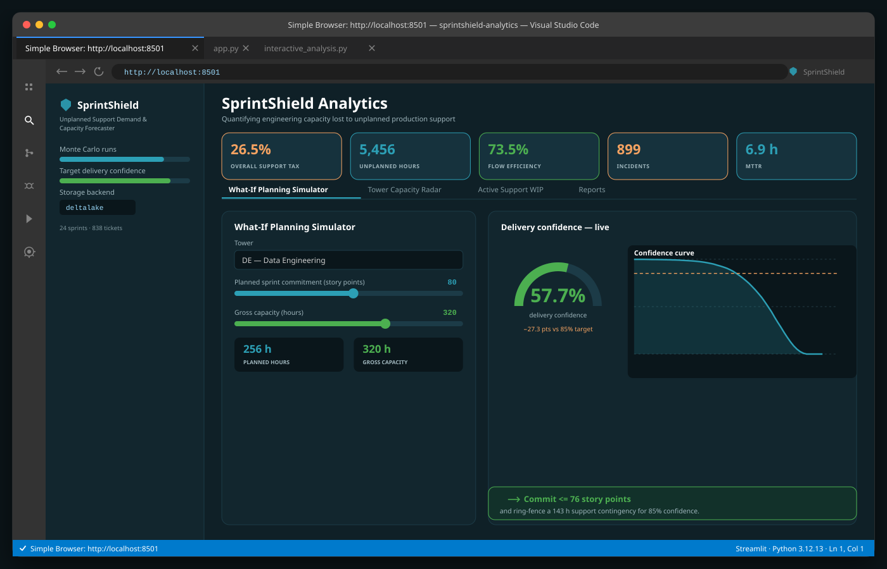
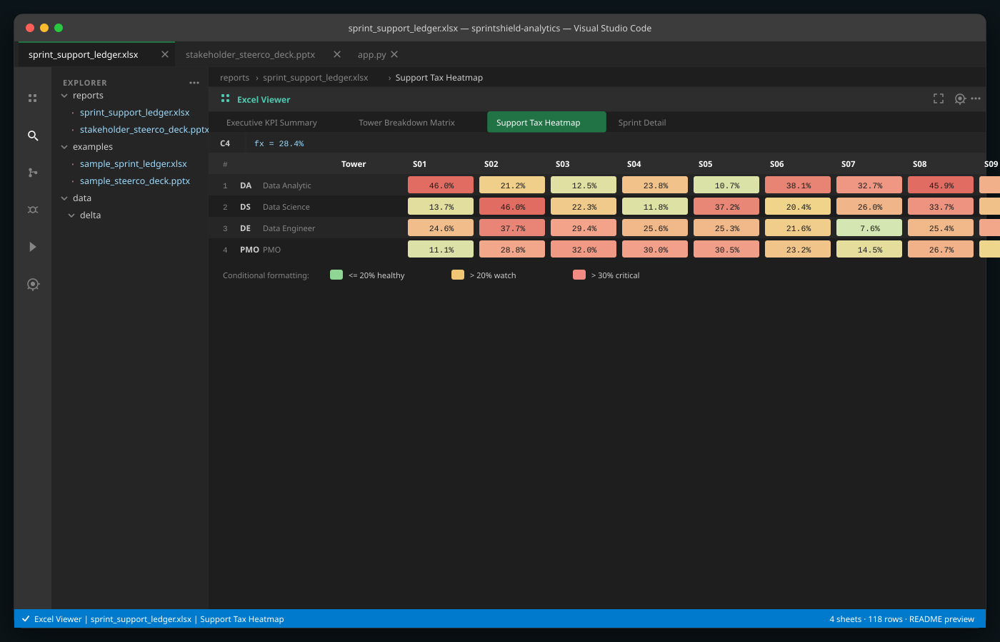

<div align="center">

# 🛡️ SprintShield Analytics

### Unplanned Support Demand & Developer Capacity Forecaster

**Quantify how much sprint engineering capacity your data towers lose to unplanned production support — then forecast delivery confidence with stochastic demand modelling and Monte Carlo simulation.**

[](.gitlab-ci.yml)
[](pyproject.toml)
[](config/storage.yaml)
[](config/storage.yaml)
[](pyproject.toml)
[](docker-compose.yml)
[](LICENSE)

</div>

---

## Table of contents

1. [Context & Motivation](#-context--motivation)
2. [Architecture Pipeline](#-architecture-pipeline)
3. [Mathematical Rigor](#-mathematical-rigor)
4. [Dual-Adapter Configuration Guide](#-dual-adapter-configuration-guide)
5. [VS Code Native Experience](#-vs-code-native-experience)
6. [Visual Previews](#-visual-previews)
7. [Quickstart](#-quickstart)
8. [Docker](#-docker)
9. [Project Layout](#-project-layout)
10. [Testing & Quality](#-testing--quality)

---

## 📌 Context & Motivation

In multi-tower data organizations, delivery capacity is quietly consumed by work that
never appears on a sprint board. A nightly pipeline breaks. An executive dashboard shows
a stale metric before a board review. A model drifts past its PSI threshold and nobody
notices until scoring degrades. Each incident is individually small; collectively they
are enormous.

We call the invisible cost the **Support Tax**:

> the share of gross sprint capacity that is consumed by unplanned production support
> instead of committed feature delivery.

Three structural problems make this hard to govern:

| Problem | Why it defeats traditional planning |
| --- | --- |
| **It is unmeasured.** | Support tickets live in a different system (Jira Service Desk) from sprint commitments (Jira Agile). Nobody joins the two, so the capacity loss is invisible on a burndown chart. |
| **It is not average.** | Incident arrival is *overdispersed*. Steady-state weeks are calm; a platform release dumps a correlated burst of tickets into one sprint. Planning with a mean is planning for a week that rarely happens. |
| **It is right-skewed.** | Most tickets close in hours. A stubborn few consume days. Averages understate the tail that actually blows a sprint. |

SprintShield attacks all three. It ingests committed-vs-completed sprint telemetry and
unplanned support tickets, models incident arrivals as a stochastic process, fits the
right-skewed resolution-effort distribution, and then runs a **10,000-iteration Monte
Carlo simulation** of the sprint. The output is not a single number — it is a
**calibrated delivery-confidence curve** that answers the only question a planner really
has:

> *"If we commit to N story points this sprint, what is the probability we actually deliver them?"*

---

## 🏗️ Architecture Pipeline



**In one line:**

```
Jira REST API / Synthetic Telemetry
   → Dual-Adapter Storage (Delta Lake / Snowflake)
      → Analytics Engine (Poisson/NegBinomial demand + Log-Normal effort → 10,000-run Monte Carlo)
         → [ VS Code Interactive Pane (# %%) | Simple Browser Dashboard (Streamlit) | Excel & PowerPoint Reports ]
```

---

## 📐 Mathematical Rigor

### 1. Dispersion index — choosing the arrival family

Incident arrivals are described by their **dispersion index**, the variance-to-mean ratio:

$$
D = \frac{\sigma^2}{\mu}
$$

* $D \approx 1.0$ — arrivals are memoryless and steady-state. Fit a **Poisson** process.
* $D > 1.2$ — arrivals are **overdispersed**; correlated batch releases are dumping
  incidents into the same sprint. Fit a **Negative Binomial**.

The Poisson probability mass function:

$$
P(N = k) = \frac{\lambda^{k} e^{-\lambda}}{k!}, \qquad \mathbb{E}[N] = \operatorname{Var}[N] = \lambda
$$

The Negative Binomial probability mass function, which introduces a free dispersion
parameter and lets variance exceed the mean:

$$
P(N = k) = \binom{k + r - 1}{k} (1 - p)^{r} p^{k},
\qquad
\mathbb{E}[N] = \frac{rp}{1-p},
\qquad
\operatorname{Var}[N] = \frac{rp}{(1-p)^{2}}
$$

SprintShield estimates $(r, p)$ by **maximum likelihood** — seeded with the
method-of-moments solution $r = \mu^{2} / (\sigma^{2} - \mu)$ and refined by a
Nelder–Mead search on the negative log-likelihood — then compares the two families on
AIC/BIC and confirms the choice with a Pearson chi-square goodness-of-fit test.

### 2. Log-Normal resolution effort

Resolution hours $X > 0$ are right-skewed, so we model $\ln X \sim \mathcal{N}(\mu, \sigma^{2})$.
The density is:

$$
f(x; \mu, \sigma) = \frac{1}{x \sigma \sqrt{2\pi}} \exp\!\left( -\frac{(\ln x - \mu)^{2}}{2\sigma^{2}} \right),
\qquad x > 0
$$

with

$$
\mathbb{E}[X] = e^{\mu + \sigma^{2}/2},
\qquad
\operatorname{Var}[X] = \left(e^{\sigma^{2}} - 1\right) e^{2\mu + \sigma^{2}}
$$

A 2-parameter **Weibull** is fitted as the competing family and the better of the two is
selected by AIC. Both are estimated per tower *and* per business asset, so a
`feature_store` incident and a `tableau_exec_dashboards` incident draw from their own
tails.

### 3. Monte Carlo net capacity simulation

For each of $R = 10{,}000$ independent sprint iterations, and each tower:

**Step 1 — sample incoming demand**

$$
N^{(i)} \sim \text{NegBinom}(r, p) \quad \text{(or Poisson}(\lambda)\text{)}
$$

**Step 2 — sample resolution effort per incident**

$$
E^{(i)}_{j} \sim \text{LogNormal}(\mu, \sigma), \qquad j = 1 \dots N^{(i)}
$$

**Step 3 — total unplanned support overhead**

$$
H_{\text{support}}^{(i)} = \sum_{j=1}^{N^{(i)}} E^{(i)}_{j}
$$

**Step 4 — net delivery capacity**

$$
H_{\text{net}}^{(i)} = H_{\text{gross}} - H_{\text{support}}^{(i)}
$$

The **delivery-confidence curve** is the empirical survival function of $H_{\text{net}}$,
evaluated against the planned commitment $H_{\text{planned}}$:

$$
P(\text{Delivery}) = \Pr\!\left[ H_{\text{net}} \ge H_{\text{planned}} \right]
= \frac{1}{R} \sum_{i=1}^{R} \mathbb{1}\!\left[ H_{\text{net}}^{(i)} \ge H_{\text{planned}} \right]
$$

The planner then inverts this at the target confidence $\alpha = 0.85$ to obtain the
**largest safe commitment** and the **support-hours contingency buffer**:

$$
H^{\star}_{\text{commit}} = Q_{1-\alpha}\!\left( H_{\text{net}} \right),
\qquad
B^{\star} = Q_{\alpha}\!\left( H_{\text{support}} \right)
$$

Because the sampler is fully vectorised over NumPy arrays, all 10,000 iterations across
every tower complete in well under a second.

---

## ⚙️ Dual-Adapter Configuration Guide

SprintShield reads telemetry through an abstract repository interface
(`src/sprintshield/storage/base.py`). Swapping backends is a configuration change —
**never a code change**. Analytics, reporting and the dashboard are entirely
backend-agnostic.

### Option A — Delta Lake (default, zero setup)

The default backend is a fully local ACID lakehouse built on the Rust-backed
[`deltalake`](https://github.com/delta-io/delta-rs) library. No server, no credentials,
no network. Tables are written as partitioned Parquet:

```
data/delta/
├── sprint_snapshots/
│   └── tower_id=DE/sprint_id=S01/part-00000-*.parquet
└── support_tickets/
    └── tower_id=DS/sprint_id=S14/part-00000-*.parquet
```

Partitioned on `["tower_id", "sprint_id"]`, so partition pruning makes per-tower and
per-sprint reads cheap.

Every write creates a new Delta **table version**, which gives you **time-travel audits**
for free — compare how the ledger looked before and after a late backfill:

```python
from sprintshield.storage.factory import get_storage_adapter

adapter = get_storage_adapter()                 # -> DeltaLakeAdapter
adapter.save_sprint_snapshots(snapshots)        # version 0
adapter.save_sprint_snapshots(late_corrections) # version 1

adapter.table_versions("sprint_snapshots")            # [0, 1]
adapter.get_sprint_history_at_version(0)              # the original ledger
adapter.compare_versions("sprint_snapshots", 0, 1)    # audit diff
```

```bash
# .env
STORAGE_BACKEND=deltalake
DELTA_LAKE_PATH=data/delta
```

### Option B — Snowflake Cloud Data Warehouse

For enterprise deployments, point the factory at your warehouse. It uses
`snowflake-connector-python` with parameter binding, connection reuse and
exponential-backoff query retries, and `snowflake-sqlalchemy` for the engine path.

```bash
pip install -e ".[snowflake]"

# .env
STORAGE_BACKEND=snowflake
SNOWFLAKE_ACCOUNT=xy12345.ap-south-1
SNOWFLAKE_USER=SPRINTSHIELD_SVC
SNOWFLAKE_PASSWORD=••••••••
SNOWFLAKE_WAREHOUSE=COMPUTE_WH
SNOWFLAKE_DATABASE=SPRINTSHIELD_DB
SNOWFLAKE_SCHEMA=TELEMETRY
SNOWFLAKE_ROLE=SYSADMIN
```

Tables resolve to `SPRINTSHIELD_DB.TELEMETRY.SPRINT_SNAPSHOTS` and
`SPRINTSHIELD_DB.TELEMETRY.SUPPORT_TICKETS`.

> **Graceful degradation.** If `STORAGE_BACKEND=snowflake` is set but the credentials
> are absent, the factory transparently falls back to Delta Lake rather than crashing
> the pipeline. CI, demos and laptops keep working.

---

## 🧑‍💻 VS Code Native Experience

SprintShield is designed to be driven entirely from inside VS Code. Open the folder —
`.vscode/settings.json`, `launch.json` and `tasks.json` are already wired up.

### 1 · Python Interactive Window (`# %%` cells)

`scripts/interactive_analysis.py` is written as `# %%` cells, so it runs natively in the
**Python Interactive Window**:

1. Open `scripts/interactive_analysis.py`
2. `Cmd/Ctrl+Shift+P` → **Python: Run Current File in Interactive Window**
3. Each cell renders inline — filterable DataFrames, Plotly confidence curves and tower
   breakdowns

```
┌─ scripts/interactive_analysis.py ────────────────────────────────────────────┐
│  # %% [markdown]                                                             │
│  # ## 6. Monte Carlo sprint capacity simulation                              │
│                                                                              │
│  # %%                                                        ▶ Run Cell      │
│  simulations, summary = simulate_all_towers(                                 │
│      CONFIG, snapshots, tickets, runs=10_000,                                │
│  )                                                                           │
└──────────────────────────────────────────────────────────────────────────────┘
```

There is also a full narrative notebook at `notebooks/sprint_capacity_audit.ipynb`.

### 2 · Simple Browser dashboard (`http://localhost:8501`)

Launch the Streamlit cockpit and view it *inside* the editor — no browser tab needed:

```bash
streamlit run src/sprintshield/dashboard/app.py --server.port=8501
```

Then in VS Code: `Cmd/Ctrl+Shift+P` → **Simple Browser: Show** → enter
`http://localhost:8501`.

Or press `F5` and pick **SprintShield: Launch Streamlit Dashboard**, which starts the
server and opens the Simple Browser for you.

The cockpit has four panels:

* **What-If Planning Simulator** — drag the planned-commitment slider and watch delivery
  confidence, mean support burn and support tax update live
* **Tower Capacity Radar** — donut, bar and radar charts showing the proportion of
  capacity absorbed by support per tower
* **Active Support WIP Monitor** — ongoing P1/P2 blockers threatening the sprint goal
* **Reports** — one-click download of the generated Excel ledger and SteerCo deck

### 3 · Excel Viewer extension

The generated `.xlsx` opens directly in the editor with the
[Excel Viewer](https://marketplace.visualstudio.com/items?itemName=GrapeCity.gc-excelviewer)
extension — conditional-formatting heatmaps, formatted numbers and all summary tabs
render in place. Right-click `reports/sprint_support_ledger.xlsx` → **Open Preview**.

---

## 🖼️ Visual Previews

**Interactive window — Monte Carlo summary and confidence curve**



**Split editor — support tax breakdown across towers**



**Simple Browser — Streamlit capacity cockpit on localhost:8501**



**Excel Viewer — the conditional-formatting support-tax heatmap**



> These SVGs are generated from a **real Monte Carlo run**, not mocked up. Re-render them
> at any time with `python scripts/generate_vscode_screenshots.py`.

---

## 🚀 Quickstart

```bash
# 1 · Clone and configure
git clone <your-repo-url> sprintshield-analytics
cd sprintshield-analytics
cp .env.example .env

# 2 · Install (editable)
pip install -e .

# 3 · Generate 24 two-week sprints (one full year) of multi-tower telemetry
python scripts/generate_sprint_telemetry.py --sprints 24

# 4 · Run the Monte Carlo capacity simulation
sprintshield simulate --gross-hours 320 --planned-points 80

# 5 · Produce the executive reports
sprintshield export --excel --pptx

# 6 · Launch the cockpit (view it in the VS Code Simple Browser)
streamlit run src/sprintshield/dashboard/app.py
```

### CLI reference

| Command | What it does |
| --- | --- |
| `sprintshield ingest --sprints 24` | Generate (or extract) telemetry and persist it to the active storage backend |
| `sprintshield train` | Fit and compare the arrival and effort distributions per tower |
| `sprintshield simulate --gross-hours 320 --planned-points 80` | Run the 10,000-iteration Monte Carlo simulation |
| `sprintshield simulate --tower DE --json-out` | Machine-readable output for one tower |
| `sprintshield export --excel --pptx` | Build `sprint_support_ledger.xlsx` and `stakeholder_steerco_deck.pptx` |
| `sprintshield report` | Print the executive KPI summary to the terminal |
| `sprintshield dashboard` | Launch the Streamlit cockpit |
| `sprintshield screenshots` | Re-render the VS Code SVG assets |

### Sample output

```
                    Monte Carlo Sprint Simulation (10000 runs)
┏━━━━━━━┳━━━━━━━━━━━━━━━━┳━━━━━━━━━━━━━━━━━━┳━━━━━━━━━━━━━━━┳━━━━━━━━━━━━━━━━━┳━━━━━━━━━━━━━━━━━┓
┃ Tower ┃ Mean Incidents ┃ Mean Support Hrs ┃ Support Tax % ┃ P85 Support Hrs ┃ Delivery Conf % ┃
┡━━━━━━━╇━━━━━━━━━━━━━━━━╇━━━━━━━━━━━━━━━━━━╇━━━━━━━━━━━━━━━╇━━━━━━━━━━━━━━━━━╇━━━━━━━━━━━━━━━━━┩
│ DE    │ 11.2           │ 78.9             │ 24.7          │ 128.8           │ 58.6            │
│ DA    │ 17.3           │ 69.9             │ 28.0          │ 110.8           │ 52.1            │
│ DS    │ 5.4            │ 57.9             │ 28.3          │ 111.4           │ 58.7            │
│ PMO   │ 3.3            │ 20.8             │ 21.6          │ 35.6            │ 69.6            │
└───────┴────────────────┴──────────────────┴───────────────┴─────────────────┴─────────────────┘
```

Read that as: Data Engineering is losing **24.7% of its sprint capacity** to unplanned
support, and if it commits to a full 96-point sprint it only clears it about **58.6%** of
the time. To hold 85% confidence, it should commit no more than **191 hours (≈76 story
points)** and ring-fence a **129-hour** support contingency.

---

## 🐳 Docker

One command starts the whole thing — telemetry generation, then the dashboard:

```bash
cp .env.example .env
docker-compose up --build
```

Then open `http://localhost:8501` (or the VS Code Simple Browser). Named volumes keep
the Delta Lakehouse and generated reports across restarts.

```bash
# Or run the image directly
docker build -t sprintshield-analytics:1.0.0 .
docker run --rm -p 8501:8501 --env-file .env sprintshield-analytics:1.0.0

# Run a one-off CLI command inside the container
docker run --rm --env-file .env sprintshield-analytics:1.0.0 \
  sprintshield simulate --gross-hours 320 --planned-points 80
```

The image runs as a non-root user and ships a `HEALTHCHECK` against Streamlit's health
endpoint.

---

## 📁 Project Layout

```
sprintshield-analytics/
├── config/                     # YAML configuration (main, storage, tower profiles)
├── docs/screenshots/           # Generated VS Code-themed SVG assets
├── notebooks/                  # sprint_capacity_audit.ipynb
├── scripts/                    # telemetry generator, interactive cells, SVG renderer, git history
├── src/sprintshield/
│   ├── client/                 # Jira REST client, auth, synthetic generator
│   ├── storage/                # base contract, Delta Lake adapter, Snowflake adapter, factory
│   ├── analytics/              # arrival model, effort distribution, Monte Carlo, metrics
│   ├── reporting/              # openpyxl Excel exporter, python-pptx deck exporter
│   ├── dashboard/              # Streamlit cockpit + pure view layer
│   └── cli.py                  # Rich-powered Click CLI
├── tests/                      # 200+ pytest tests
└── examples/                   # Verified sample ledger and deck
```

---

## ✅ Testing & Quality

```bash
pytest --cov=sprintshield --cov-report=term-missing --cov-fail-under=88
```

| Gate | Result |
| --- | --- |
| Test suite | **206 tests, 100% green** |
| Line + branch coverage | **> 97%** (threshold enforced at 88%) |
| Modules at 100% | `storage/base.py`, `storage/__init__.py`, `client/auth.py`, `reporting/excel_exporter.py` |
| Dashboard | Driven end-to-end by Streamlit's own `AppTest` harness — zero render exceptions, live What-If slider verified |
| Lint | `ruff check src tests scripts` |
| CI | `.gitlab-ci.yml` — lint → pytest with coverage → telemetry build → screenshot render |

The suite drives the Jira client entirely offline through `httpx.MockTransport` (pagination,
retries, changelog and worklog parsing), exercises Delta Lake round-trips and time-travel
audits against a temporary lakehouse, and verifies both Office exporters by reopening the
generated files with `openpyxl` and `python-pptx`.

---

## 📄 License

MIT — see [LICENSE](LICENSE).

<div align="center">
<sub>Built by <b>Vinothkumar N</b> · SprintShield Analytics v1.0.0</sub>
</div>
